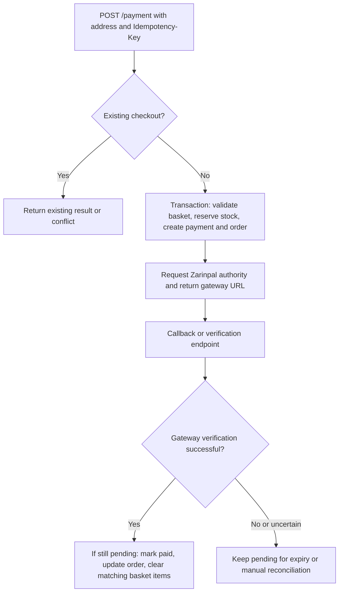

# 🛍️ Online Store Backend

**A modular e-commerce REST API built with Node.js, Express, Sequelize, and TiDB.**

Hi! 👋 I built this project to practice the parts of backend development that go beyond basic CRUD: authentication, access control, product variants, stock reservations, checkout, and order management. I wanted to understand how these pieces fit together, and how a system behaves when something goes wrong.

**Portfolio MVP · v1.0.0**

## 🚀 Explore in a minute

| | Link |
|---|---|
| 📖 API documentation | [Swagger UI](https://online-store-qihx.onrender.com/api-docs/) |
| 💚 Health check | [Server status](https://online-store-qihx.onrender.com/health) |
| 📄 OpenAPI specification | [API JSON](https://online-store-qihx.onrender.com/api-docs.json) |
| 💻 Source | [GitHub repository](https://github.com/zahramalekpour/online-store) |

**Reviewing the project?** Swagger is the quickest starting point; no local setup is needed to browse the API. Protected operations require authentication, and admin actions require the appropriate role or permission. Please avoid triggering payment requests or changing live demo data. The hosted service may need some time to wake after inactivity.

## ✨ Features

| Area | What it does |
|---|---|
| 🔐 Authentication | OTP login workflow, JWT access/refresh tokens, logout |
| 📦 Products | Create, list, view, and remove products; color and size variants |
| 🛒 Basket | Item management, stock checks, pricing, discounts |
| 🧾 Orders | Customer order history and controlled fulfillment states |
| 💳 Payments | Zarinpal integration, server-side verification, checkout idempotency |
| 🛡️ RBAC | Roles, permissions, and role-permission assignment |
| 👤 Admin | User search, pagination, profile updates, role assignment |

**A few details worth exploring:** Checkout uses transactions and reserves stock before initiating gateway payment. Basket and order reads are scoped to the authenticated user. Admin operations use role checks, with granular permission checks on user-management endpoints.

### Checkout flow



Reservations are set to **20 minutes**. A separate expiration worker handles eligible pending payments. If a callback arrives after the worker has already released a reservation, the verification handler **does not complete the order as paid**: it returns a conflict requiring reconciliation or refund handling. An automated late-payment refund/reconciliation flow is not implemented as part of the verified checkout handler.

## 🧰 Tech stack

| Layer | Tools |
|---|---|
| Runtime / API | Node.js, Express.js |
| Data | Sequelize, TiDB (MySQL-compatible) |
| Database connection | MariaDB dialect / driver |
| Authentication | JWT, OTP |
| Authorization | Roles and permission middleware |
| Payments | Zarinpal |
| Documentation | OpenAPI / Swagger UI |
| Testing | Jest, Supertest, Postman |
| Hosting | Render |

## 🧠 Technical decisions — why these choices?

**Why Node.js and Express?** Node.js fits an API that waits on database and gateway I/O. Express keeps routing, middleware, and request handling visible and flexible. **Trade-off:** I have to maintain consistent structure and validation myself.

**Why relational data and TiDB?** Users, products, variants, orders, and payments have explicit relationships, and checkout benefits from transactions. TiDB offers a MySQL-compatible SQL interface. The project currently connects using Sequelize's `mariadb` dialect; this works for the configured connection, but compatibility does not imply identical support for every DDL operation.

**Why Sequelize?** Models, associations, and transactions make related operations easier to organize in JavaScript, including creating products with variants. **Trade-off:** ORM abstractions still require an understanding of SQL, constraints, and database behavior. After a TiDB schema-alteration issue, automatic `sequelize.sync({ alter: true })` was disabled; migrations are planned.

**Why JWT, OTP, and RBAC?** OTP provides a phone-based sign-in flow; JWT authenticates API requests. Roles protect administrator functions, and permissions allow finer controls for user administration. **Trade-off:** token lifecycle and permission assignments require careful validation and maintenance.

**Why reserve stock before payment?** It reduces the risk of starting payment for unavailable items. **Trade-off:** unpaid checkouts temporarily hold stock, so expiration and reconciliation are necessary.

**Why idempotency keys?** A repeated checkout request should not automatically create a second order. `POST /payment` requires a **16–80 character** `Idempotency-Key`, stored as `Payment.checkoutKey` and checked per user. The Sequelize model does not itself declare a unique constraint on this field; concurrency guarantees depend on the deployed database schema and are a follow-up verification item.

**Why explicit order transitions?** Once payment is confirmed, an order moves to `inProcess`, then an admin can move it through `packed` → `inTransit` → `delivery`. Cancellation is permitted from `inProcess`, `packed`, or `inTransit`, and requires a reason. **Trade-off:** transitions must be maintained as business rules evolve.

**Why Jest and Supertest?** They let me test success and failure paths—including authorization failures, insufficient stock, and duplicate checkout attempts—without relying only on manual API checks. **Trade-off:** mocked unit tests don't replace integration tests against a real database and gateway.

## 🧪 Tests

Latest local Jest run:

| Metric | Result |
|---|---:|
| Test suites | **12 passed** |
| Tests | **162 passed** |
| Line coverage | **76.39%** |
| Branch coverage | **59.46%** |

```bash
npm test
npm run test:coverage
```

## 🗂️ Structure

```text
online-store/
├── common/                 # Shared constants
├── config/                 # Database and API documentation config
├── middlewares/            # Shared middleware
├── modules/
│   ├── auth/               # Authentication
│   ├── admin/              # User management
│   ├── product/            # Products and variants
│   ├── basket/             # Shopping basket
│   ├── order/              # Orders
│   ├── payment/            # Checkout and reservations
│   ├── RBAC/               # Roles and permissions
│   ├── user/               # User models
│   └── zarinpal/           # Gateway integration
├── test/                   # Automated tests
├── app.js
├── server.js
└── package.json
```

## ⚙️ Run locally

If you're reviewing the project, the [hosted Swagger UI](https://online-store-qihx.onrender.com/api-docs/) is the fastest route.

```bash
git clone https://github.com/zahramalekpour/online-store.git
cd online-store
npm install
```

Set up a private `.env` with your own database settings, token secrets, and gateway test configuration. The application expects the database tables and relationships to exist; **automatic schema alteration is disabled**. A standalone schema bootstrap script and a verified `.env.example` are not currently supplied, so a fresh database setup needs additional configuration.

```bash
npm start
# or
npm run dev
```

Never commit credentials. Use a test gateway configuration rather than a real purchase when exploring checkout.

## 🧭 What's next?

This release is a **portfolio demonstration**. The next improvements I'd like to work on are:

- Reproducible setup with `.env.example`, database schema migrations, and seed data
- Real-database concurrency tests and verification of checkout-key uniqueness
- Automated reconciliation/refund handling for late payment confirmation
- Deeper OTP and gateway integration tests
- Product search and pagination
- Dependency security fixes (the latest local audit reported three moderate findings in Swagger-related dependencies)

## 💬 Feedback

Thanks for taking a look! 👋 Feedback and code-review suggestions are welcome through [GitHub Issues](https://github.com/zahramalekpour/online-store/issues).